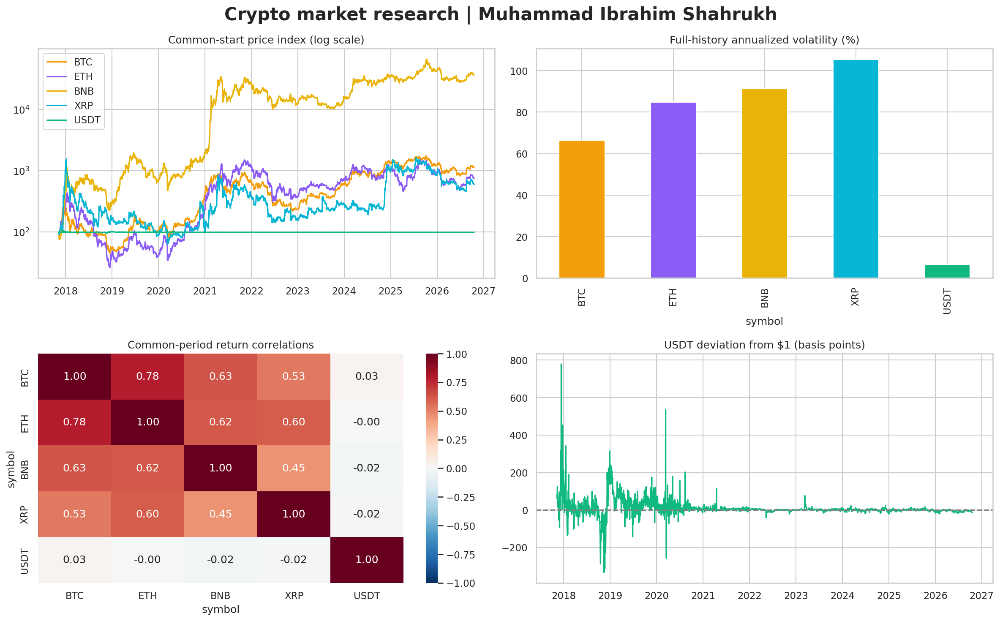

# Crypto Prices: EDA & 2026 Forecasts

**Author: Muhammad Ibrahim Shahrukh**

Clean daily USD data for Bitcoin, Ethereum, Tether, BNB and XRP, with an executed exploratory notebook and a transparent comparison of baseline and machine-learning forecasts through December 31, 2026.



## Dataset at a glance

- 17,479 rows and nine columns in a tidy CSV.
- BTC: September 17, 2014–October 18, 2026. ETH, USDT, BNB and XRP: November 9, 2017–October 18, 2026.
- No missing clean values, duplicated date/ticker keys or calendar gaps within each asset's available history.
- Five potentially incomplete October 19 observations excluded; the BNB row also has a close above its high. Exclusions are preserved, not repaired with invented values.
- 370 daily forecasts: 74 calendar days for each asset, October 19–December 31, 2026.

These are cryptocurrencies, not stocks. The source is a user-supplied Yahoo Finance/yfinance export. The original collection timestamp and settings are unknown, and prices were not independently re-downloaded for verification.

## What is included

| Path | Purpose |
|---|---|
| `crypto_eda_2026_forecasts.ipynb` | Executed, colorful EDA and forecasting notebook |
| `data/major_crypto_daily_clean.csv` | Beginner-friendly observation table |
| `data/excluded_observations.csv` | Original excluded rows and reasons |
| `data/quality_report.json` | Counts, source checksum and integrity checks |
| `data/raw/major_crypto.csv` | Unmodified supplied source snapshot |
| `docs/KAGGLE_DATASET_GUIDE.md` | Copy-ready metadata, data dictionary, provenance and methodology |
| `docs/DATASET_COVER_PROMPT.md` | Ready-to-use image-generation prompt |
| `docs/data_dictionary.csv` | Column definitions |
| `docs/RESULTS_GUIDE.md` | Forecast and evaluation output definitions |
| `scripts/clean_data.py` | Reproducible cleaning from the original export |
| `scripts/download_data.py` | Optional new-data collector with explicit settings |
| `scripts/execute_notebook.py` | Execute and save the notebook locally |
| `results/` | Model rankings, holdout metrics, predictions and interpretation |
| `figures/` | Static dashboard and offline interactive HTML charts |
| `requirements.txt` | Runtime dependencies |
| `requirements-tested.txt` | Exact versions of key packages used for this delivery |
| `.gitignore` | Excludes environments, caches, credentials and temporary files |

## Local setup

Python 3.10+ is recommended. From the extracted repository folder:

```bash
python -m venv .venv
```

Activate on Windows PowerShell:

```powershell
.venv\Scripts\Activate.ps1
```

Activate on macOS/Linux:

```bash
source .venv/bin/activate
```

Install and open:

```bash
python -m pip install -r requirements.txt
jupyter lab crypto_eda_2026_forecasts.ipynb
```

Run every cell from top to bottom. Or execute without opening a browser:

```bash
python scripts/execute_notebook.py
```

The notebook does not require internet access once dependencies and the dataset are present. It writes results and charts to the local repository, or to `/kaggle/working` on Kaggle. Multiple matching clean CSVs cause an explicit error; set `DATA_PATH` in the setup cell if needed.

## Reproduce the cleaned data

```bash
python scripts/clean_data.py data/raw/major_crypto.csv --output data --snapshot-date 2026-10-19
```

The cleaner parses both header levels, drops empty pre-coverage blocks, standardizes names, validates numeric values and OHLC, preserves exclusions, and sorts by date/ticker. No prices are filled, clipped or fabricated. The original hash is in `data/quality_report.json`.

Optional new collection (internet required):

```bash
python -m pip install yfinance
python scripts/download_data.py --snapshot-date 2026-10-19 --output data/raw/major_crypto_refreshed.csv
```

The collection command is a documented recipe, not the unknown original download command. It excludes the snapshot date using yfinance's exclusive `end` argument. Later downloads may differ due to provider revisions. Do not overwrite the original snapshot without recording a new version.

## Modeling and honest evaluation

Features are available at the forecast origin; targets are direct cumulative log returns for all 74 future days. Up to four recent years are used for training. Every training target must finish on or before its origin. Scalers fit only on training data.

Three non-overlapping historical validation paths select a candidate by mean WAPE. Models include two Ridge strengths, Extra Trees, last price, recent log drift, and a $1 peg candidate for USDT. The final 74-day block is untouched until evaluation. Final predictions refit the already selected model using all eligible completed history. See `results/chronological_splits.csv` for exact dates.

### Held-out results

| symbol | selected_model | mae_usd | wape_pct | mae_skill_vs_last_price |
|---|---|---|---|---|
| BTC | Last price | 13,355.086782 | 17.189 | +0.00% |
| ETH | Extra Trees | 555.435145 | 22.966 | -7.35% |
| BNB | Last price | 118.943973 | 16.703 | +0.00% |
| XRP | Last price | 0.297805 | 22.194 | +0.00% |
| USDT | Last price | 0.000572 | 0.057 | +0.00% |

Validation selected **Last price** for BTC, BNB, XRP and USDT and **Extra Trees** for ETH. ETH's selected model had about **7.35% higher MAE** than the last-price baseline on the held-out period. The notebook reports this failure rather than changing the winner after seeing the test. Simple baselines are meaningful outcomes, not a promise that future prices will be flat.

The 2026 forecast bands are illustrative, based on validation log errors and a square-root-horizon assumption. They do not have guaranteed 90% coverage. Some test coverage is substantially below 90%; see `test_metrics.csv`. A small USDT forecast error does not rule out a future depeg. This project does not model news, liquidity, token events, trading costs or fundamental value.

Full findings and year-end projections are in [analysis_summary.md](results/analysis_summary.md). Historical data and predictions are intentionally stored in separate files.

## Visualization and notebook compatibility

The notebook has 13 themed sections, colored explanatory panels, 14 Plotly outputs and a Matplotlib dashboard. Plotly outputs contain native Plotly MIME plus embedded HTML. Key charts are also saved as self-contained HTML with the JavaScript included, so they work offline when opened locally. GitHub notebook previews may not run JavaScript; the static dashboard still renders. Kaggle may require running imported cells before interactive plots appear.

All 15 code cells were executed sequentially in a fresh in-process IPython session with zero errors. Socket-based Jupyter kernels are unavailable in the preparation environment, so this was not a live Kaggle execution. The execution report records that limitation and output counts. The notebook schema and exported CSVs were validated, and the static dashboard was visually inspected. `scripts/execute_notebook.py` uses a standard Jupyter kernel on your machine.

## Publish on Kaggle and GitHub

Use [KAGGLE_DATASET_GUIDE.md](docs/KAGGLE_DATASET_GUIDE.md) for the title, subtitle, description, column definitions and file description. Upload the historical CSV as the dataset and attach it to the imported notebook. Do not label forecast rows as real market observations.

Suggested GitHub repository name: `major-crypto-prices-eda-2026-forecast`

Suggested description: `Daily BTC, ETH, USDT, BNB and XRP data with interactive EDA, audited cleaning, chronological model evaluation and 2026 forecasts.`

After extracting this folder and checking the data-use terms, you can initialize a local repository:

```bash
git init
git add .
git commit -m "Add crypto dataset, EDA notebook and evaluated 2026 forecasts"
git branch -M main
```

Create an empty repository on GitHub, then add its exact URL as the remote and push. No repository has been published by this package.

## Data rights and citation

yfinance is an independent software project. Its software license does not grant redistribution rights to Yahoo Finance data. Its README describes the API as intended for personal use and directs users to Yahoo's terms. Review the source terms before publishing the raw or cleaned data, and do not label it CC0 or otherwise openly licensed without a valid basis. This package does not assign a blanket license to third-party data. See [DATA_RIGHTS.md](DATA_RIGHTS.md).

Suggested citation: Muhammad Ibrahim Shahrukh (2026). *Crypto Historical Prices: BTC ETH USDT BNB XRP*. User-supplied Yahoo Finance/yfinance snapshot, completed observations through October 18, 2026. Add your published dataset URL and version.

- [Yahoo Finance BTC-USD historical data](https://finance.yahoo.com/quote/BTC-USD/history/)
- [Yahoo Finance ETH-USD historical data](https://finance.yahoo.com/quote/ETH-USD/history/)
- [Yahoo Finance USDT-USD historical data](https://finance.yahoo.com/quote/USDT-USD/history/)
- [Yahoo Finance BNB-USD historical data](https://finance.yahoo.com/quote/BNB-USD/history/)
- [Yahoo Finance XRP-USD historical data](https://finance.yahoo.com/quote/XRP-USD/history/)
- [yfinance project and data-use notice](https://github.com/ranaroussi/yfinance)
- [yfinance download API](https://ranaroussi.github.io/yfinance/reference/api/yfinance.download.html)
- [scikit-learn time-series cross-validation guidance](https://scikit-learn.org/stable/modules/generated/sklearn.model_selection.TimeSeriesSplit.html)
- [Plotly renderer documentation](https://plotly.com/python/renderers/)

Educational research only. Model projections are uncertain and are not investment advice.
